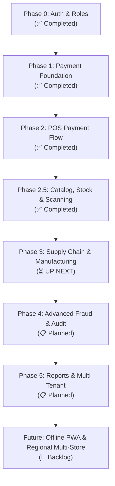

# Neil Lewz — Master Implementation Plan

**Project:** Neil Lewz — Peanut Butter & Natural Goods Platform  
**Architecture:** Next.js 16 (App Router) · Supabase (PostgreSQL + RLS + Storage) · Vanilla CSS Modules · Telegram Bot · Cloudflare Workers  
**Target Market:** Ethiopia 🇪🇹 · Bilingual (Amharic + English) · Mobile-First POS & Storefront  

---

## 0. Original Client Requirements Checklist

| # | Requirement | Status | Implemented In |
|---|---|:---:|---|
| 1 | Robust backend for inventory & sales | ✅ Done | Phase 1, Phase 2, Phase 2.5 (`stock_movements`, `orders`, `pos/sale`) |
| 2 | Raw peanuts → roast → peel/clean → press (butter) / press (oil) | ⏳ Up Next | **Phase 3** (Manufacturing & Yield Tracking) |
| 3 | Supermarket-style handling of packed items (jelly, pumpkin seed oil, honey) | ⏳ Planned | **Phase 3** (Resold goods & third-party barcodes) |
| 4 | On-premise packaging with QR + barcodes | ✅ Done | **Phase 2.5** (`/admin/inventory/labels` with Code 128 + QR) |
| 5 | Track location: warehouse → shelf → sold | 🟡 Partial | Phase 2.5 (ledger movements) → **Phase 3** (explicit locations) |
| 6 | Control kiosk employees: what they sold / packaged | ✅ Done | Phase 2, Phase 2.5 (`operator_id` attribution on POS orders) |
| 7 | Auto transaction ID for payment proof (customer + POS) | ✅ Done | Phase 1 (`NL-[SEQ]-[RANDOM6]`, duplicate reference validation) |
| 8 | Online order: payment instructions page + proof upload | ✅ Done | Phase 1 & 2.5 (`/pay/[orderNumber]` with CBE/Telebirr + Tesseract OCR) |
| 9 | POS: QR/account display, photo of customer's screen, OCR matching | ✅ Done | Phase 2 (`PosCheckout.tsx` with Tesseract.js OCR & manual override) |

---

## 1. System Status Snapshot (October 2026)

### ✅ Completed
- **Phase 0 — Identity & Roles:**
  - Supabase Auth with Google OAuth + PIN pad entry for kiosk operators.
  - Role-based routing: `admin` → Admin Dashboard, `employee`/`kiosk_operator` → Kiosk/Staff, `customer` → Account.
  - Admin accounts & role management (`/admin/employees/AccountsClient.tsx`).
- **Phase 1 — Payment Foundation:**
  - Standardized transaction ID generator (`NL-[SEQ]-[RANDOM6]`).
  - Dedicated customer payment page (`/pay/[orderNumber]`) with bank details, CBE QR, and proof upload to Supabase Storage.
  - Admin payment review queue (`/admin/payments`) with approve/reject workflow.
  - Telegram bot notifications with bidirectional approval commands.
- **Phase 2 — Complete POS Payment Flow:**
  - Kiosk point-of-sale workflow (`/kiosk`) with cash, Telebirr, and CBE Birr options.
  - Camera capture and client-side OCR (Tesseract.js) for customer transfer receipts.
  - Non-blocking cashier flow with operator attribution and silent flags for admin review.
- **Phase 2.5 — Catalog, Stock Ledger, Labels & Scanning:**
  - **Catalog Management (`/admin/products`):** Image drop zone/camera capture, auto-resize to WebP, SKU & barcode generation, archive instead of hard delete.
  - **Stock Ledger (`/admin/inventory`):** Append-only `stock_movements`, lot/batch tracking, receive/adjust drawers, low-stock/expiry alerts.
  - **Label Generation (`/admin/inventory/labels`):** Code 128 barcode and QR printing with print-specific CSS.
  - **Kiosk Hardware & Scanning:** Continuous camera scanning (`html5-qrcode`) and USB/Bluetooth keyboard-wedge scanner support (`useScanner.ts`).
  - **Stock Enforcement:** Industry-standard pre-flight stock checks (`stock.ts`), capping cart quantity and preventing overselling.
  - **Live Updates & Theming:** Realtime Supabase + polling (`LiveRefresh.tsx`), dark/light theme tokens (`--a-*`), responsive mobile drawers.
- **Latest Polish & Enhancements (Oct 9, 2026):**
  - **OCR on Online Payment:** Automated receipt scanning on `/pay/[orderNumber]` with confidence banners and auto-filled references.
  - **Kiosk Order Queue Panel:** Operator slide-out drawer showing daily orders, instant cash badge vs digital payment confirmation status (`chipGreen`, `chipAmber`, `chipRed`).
  - **Admin Activity Timeline (`/admin/activity`):** Unified chronological event stream merging order status logs and stock movements.

---

## 2. Phased Roadmap

---

## 3. Immediate Next Phase: Phase 3 — Supply Chain & Manufacturing

> [!IMPORTANT]
> Phase 3 transforms the platform from a retail POS/storefront into a complete peanut processing and manufacturing ERP.

### 3.1 Raw Material Lot Tracking
- **Suppliers/Farmers Register:** Supplier contact details, sourcing regions, purchase history, and price-per-kg trends.
- **Raw Peanut Intake:** Intake batches with moisture level, grade/quality notes, total raw weight (kg), and landed cost per kg.
- **Automatic Expense Association:** Intake logs automatically push expense records to the financial ledger.

### 3.2 Production Stage Workflows & Yield Engine
Track the end-to-end transformation across distinct production stages:
1. **Roasting:** Input raw peanuts (kg) → temperature/time profile → roasted peanuts output (kg) + roasting weight loss.
2. **Peeling / Cleaning:** Roasted peanuts (kg) → husks/waste removal (kg) → cleaned blanched nuts output (kg).
3. **Pressing (Butter vs Oil):** Cleaned nuts allocated to either:
   - **Peanut Butter Mill:** Cleaned peanuts + salt/honey inputs → finished butter batches (kg).
   - **Oil Expeller:** Cleaned peanuts → cold-pressed peanut oil (Liters) + peanut cake byproduct (kg).
4. **Yield Calculations:** Automated formula calculating mass balance and conversion efficiency:
   $$\text{Yield \%} = \frac{\text{Finished Output (kg)}}{\text{Raw Peanut Input (kg)}} \times 100$$
   Flag anomalous yield drops (e.g. machine wear, high waste, or shrinkage).

### 3.3 Product Categorization: Manufactured vs Resold
- **Manufactured Goods:** Peanut butter variants (smooth, crunchy, spiced), cold-pressed oil, roasted snacking nuts. Generated with internal lot numbers and internal QR/barcodes.
- **Resold Goods:** Packaged honey, flavored honey, strawberry jelly/marmalat, pumpkin seed oil. Scanned and received using manufacturer third-party EAN-13/UPC barcodes.

### 3.4 Multi-Location Stock Tracking
Explicit location state machine for stock items:
$$\text{SUPPLIER} \longrightarrow \text{WAREHOUSE (Raw Storage)} \longrightarrow \text{PRODUCTION} \longrightarrow \text{SHELF (Kiosk)} \longrightarrow \text{SOLD / RETURNED}$$
- Every transfer creates a signed movement record (operator, timestamp, from-location, to-location).

---

## 4. Phase 4 — Advanced Fraud Prevention & Audit Logging

1. **Immutable Audit Trail:**
   - Database-level triggers capturing `actor_id`, `action_type`, `table_name`, `before_state`, and `after_state`.
   - Admin view with tamper-evident audit history.
2. **Soft Deletes & Recycle Bin:**
   - Transition all deletes to soft deletes (`deleted_at`, `deleted_by`) across products, batches, orders, and payments.
3. **Automated Anomaly & Fraud Detection:**
   - Order marked paid then cancelled with proof attached.
   - Cashier cart clears / voids after items scanned.
   - Deletion or modification of completed transactions triggers instant high-priority Telegram alert.
4. **Proof Cross-Verification:**
   - Image metadata timestamp analysis against declared transaction time.

---

## 5. Phase 5 — Advanced Reporting & Multi-Tenant Prep

1. **Analytics & Financial Reporting:**
   - Custom date-range pickers with quick presets (Today, Yesterday, Last 7 Days, Month to Date, Year to Date).
   - Gross revenue, net profit margin, COGS (Cost of Goods Sold based on batch inputs), inventory valuation.
   - Cashier shift closeout and daily drawer reconciliation (Z-Report).
   - Export reports to CSV, Excel, and printable PDF.
2. **Multi-Tenant / Branch Architecture:**
   - `tenant_id` or `branch_id` across orders, stock locations, and users.
   - Configurable tenant settings table for store branding, payment numbers (Telebirr/CBE accounts), and Telegram chat IDs.

---

## 6. Action Items & Decisions Needed

> [!NOTE]
> Please review and confirm the following operational details before we start Phase 3:
> 1. **Batch Granularity:** Do you want each production step (Roast → Peel → Press) logged as separate steps, or a simplified "Raw Peanut In → Finished Jars Out" daily batch?
> 2. **Stock Locations:** Are all operations currently in one facility (roaster + kiosk at same spot), or is raw material stored separately from the retail shelf?
> 3. **Scale/Measurement Input:** Will employees enter output weights manually from physical scales, or do you require barcode batch printing directly at pressing time?
