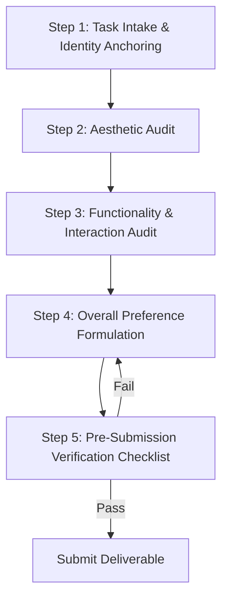

# Standard Operating Procedure (SOP): Web Application & UI Evaluation Annotation

- **Document Version:** 1.0.0  
- **Effective Date:** October 15, 2026  
- **Target Audience:** Human Evaluators, QA Reviewers, and Autonomous AI Agents  
- **Domain:** UI / Web Application Comparative Evaluation (RLHF / Preference Benchmarking)  
- **Reference Projects:** UI Berry, SolNext CA, Run65, Sp6  

---

## 1. Objective & Purpose

The purpose of this Standard Operating Procedure (SOP) is to establish standardized, rigorous, and repeatable evaluation protocols for side-by-side web application assessments (Website A vs. Website B). 

By adhering to this SOP, evaluators (both human and AI) eliminate subjective speculation, prevent category conflation, ensure strict compliance with automated parsing templates, and deliver 10/10 audit scores.

---

## 2. Core Operational Principles (The 5 Golden Rules)

```
┌────────────────────────────────────────────────────────────────────────┐
│                        THE 5 GOLDEN RULES                              │
├────────────────────────────────────────────────────────────────────────┤
│ 1. ZERO INVERSION: Verify candidate identity before writing.          │
│ 2. MANDATORY OPENER: Always start with "Website [A/B] is better..."   │
│ 3. STRICT ISOLATION: Aesthetics ≠ Functionality. Never bleed categories│
│ 4. EVIDENCE ONLY: If not visibly proven in capture, it does not exist. │
│ 5. BALANCED ANALYSIS: Always critique BOTH sides (pros & cons).        │
└────────────────────────────────────────────────────────────────────────┘
```

---

## 3. Workflow Stages



---

## 4. Detailed Evaluation Protocol

### Step 1: Identity Anchoring (Zero-Inversion Protocol)
*Critical failure point identified in Audit Tasks #6246411 & #6259337.*

Before evaluating, explicitly record the physical visual markers of both candidates:
* **Website A Anchor:** Note header title, primary brand color, layout type, and unique hero text.
* **Website B Anchor:** Note header title, primary brand color, layout type, and unique hero text.
* **The "Blank Page" Trap:** If one website fails to render (white screen, fatal JS error), triple-check whether it is A or B before drafting. An inversion turns a correct pick into a complete failure.

---

### Step 2: Aesthetics Rationale Protocol
*Aesthetics covers visual presentation, brand execution, and styling ONLY.*

#### Mandatory Inclusions:
* **Visual Hierarchy & Balance:** Typography scale, font weight hierarchy, header-to-body proportion, margin/padding consistency.
* **Color & Contrast:** Palette harmony, WCAG contrast readability, dark mode/light mode execution.
* **Modern UI Styling:** Exact techniques observed (e.g., glassmorphism, frosted card overlays, drop-shadow depth, border radiuses).
* **Prompt Asset Fit:** How well generated images, illustrations, or 3D models align with the prompt context.

#### Strict Aesthetics Prohibitions:
* ❌ **NO Behavioral/Interactive Discussion:** Do NOT discuss whether games start, forms submit, modals open, or links work. That belongs strictly in Functionality.
* ❌ **NO Subjective Filler / Vague Jargon:** Banned phrases include:
  * *"awesome feel"*
  * *"looks slick/modern"* (without naming the exact CSS/visual properties)
  * *"more refined than Website A"* (must explicitly describe what makes it refined)

---

### Step 3: Functionality Rationale Protocol
*Functionality covers interactive mechanics, behavioral integrity, and error states ONLY.*

#### Mandatory Inclusions:
* **State Changes & Interactions:** Exact observed reactions to clicks (e.g., "transitions to 'Ready to share' state", "displays a live preview pane", "opens a consultation dialog").
* **Defects & Regressions:** Screen flickering, unhandled script crashes, 404 dead links (specify exact paths, e.g., "footer regional landing pages terminate on 404 Page Not Found").
* **Feature Completeness:** Live previews, download/export formats (PDF, HTML, copy-to-clipboard), form input responsiveness.

#### Strict Functionality Prohibitions:
* ❌ **NO Visual Appearance Critiques:** Do NOT critique how labels, badges, or buttons look (color, shape, alignment) in Functionality.
* ❌ **NO Hallucinated / Assumed Interactivity:** Never claim *"seamless interactivity"* or *"smooth multi-step checkout clicks"* unless the screen recording explicitly demonstrates the user clicking and verifying the reaction.

---

### Step 4: Overall Preference Formulation

The overall evaluation must synthesize the trade-off between Aesthetics and Functionality:
1. **Mandatory Syntax Opener:** Every rationale MUST open with the exact template phrase:
   > `"Website [A/B] is better because [primary decisive reason]..."`
2. **Two-Sided Requirement:** Always present a balanced comparison:
   * Acknowledge at least one positive or redeeming factor of the losing website.
   * State clearly why the winner's advantages outweigh the loser's shortcomings.
3. **Format Integrity:** Avoid fragmented one-sentence paragraphs. Present arguments in structured, cohesive blocks.

---

## 5. Comparative Anti-Pattern Guide (What to Avoid vs. What to Do)

### Example 1: Template Formatting
* ❌ **INCORRECT:** `"Website B has cleaner icons and the footer links actually work."`  
  *(Fails mandatory opening syntax)*
* ✅ **CORRECT:** `"Website B is better because it provides functional navigation and higher contrast typography, whereas Website A suffers from broken footer links."`

### Example 2: Category Bleed
* ❌ **INCORRECT (in Aesthetics):** `"Website A has a better aesthetic because the navigation bar allows you to launch the minigame."`  
  *(Launching a minigame is a functional attribute, not aesthetic)*
* ✅ **CORRECT (in Aesthetics):** `"Website A is better because its navigation bar maintains clean typographic hierarchy and consistent 16px padding, whereas Website B uses cramped font spacing with poor contrast."`

### Example 3: Subjective Slang vs. Objective Fact
* ❌ **INCORRECT:** `"Website B just lacks that awesome, professional feel."`  
  *(Vague, subjective, zero actionable feedback)*
* ✅ **CORRECT:** `"Website B lacks visual polish due to mismatched serif and sans-serif headers, unpadded input fields, and uneven card drop-shadows compared to Website A's consistent frosted glass cards."`

### Example 4: Unverified Claims
* ❌ **INCORRECT:** `"Website B provides a seamless checkout experience with fast interactive funnel clicks."`  
  *(Capture showed no controls were clicked)*
* ✅ **CORRECT:** `"Website B visibly displays clear order line pricing and SKU details on the active dashboard, whereas Website A leaves the secondary tab blank."`

---

## 6. Pre-Submission Quality Checklist (The 6-Point Audit)

Run this checklist before submitting any deliverable:

```markdown
- [ ] 1. Identity Check: Did I verify that Website A and Website B are NOT inverted?
- [ ] 2. Template Opener: Does the rationale open with: "Website [A/B] is better because..."?
- [ ] 3. Category Isolation (Aesthetics): Are all points purely visual? (Zero functional/click claims)
- [ ] 4. Category Isolation (Functionality): Are all points behavioral? (Zero visual styling claims)
- [ ] 5. Evidence Verification: Did I personally observe every claimed click, transition, and state change?
- [ ] 6. Balanced Review: Did I evaluate BOTH candidate sites (mentioning pros/cons for each)?
```

---

## 7. Performance Benchmarks

* **Target Submission Score:** `≥ 8.5 / 10`
* **Zero-Tolerance Quality Gates:**
  * Inverted Website Identity = Instant Task Rejection
  * Missing Template Opener = Minor Non-Compliance Flag
  * Category Bleed / Subjective Slang = Rework / Rewriting Penalty
